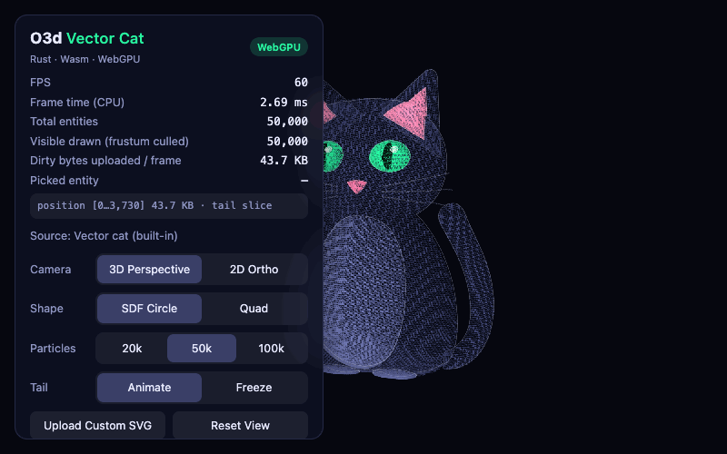
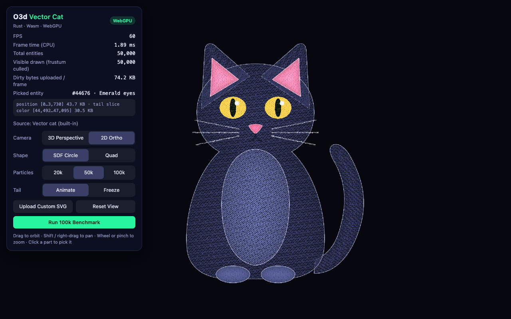
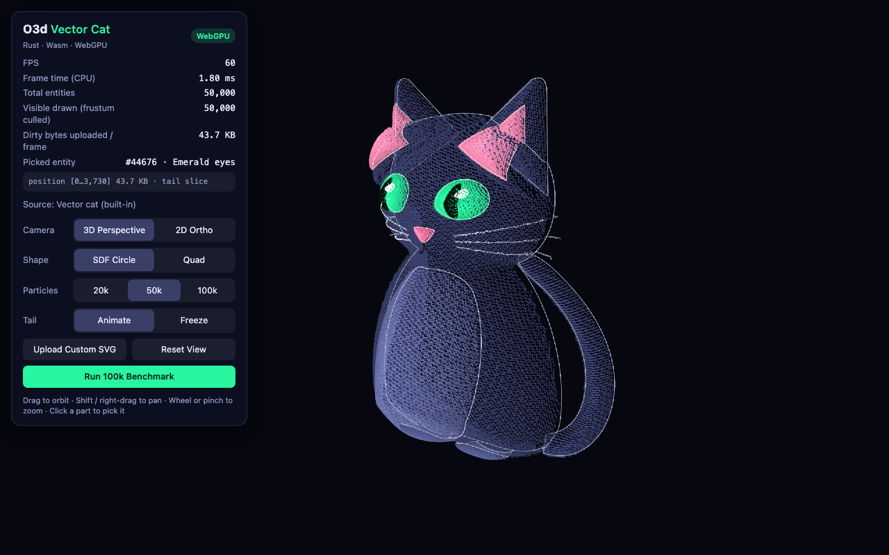
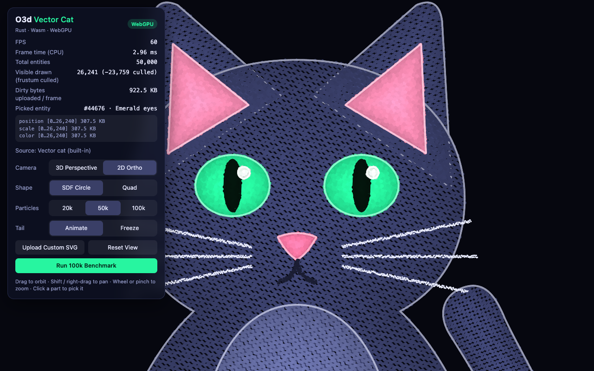
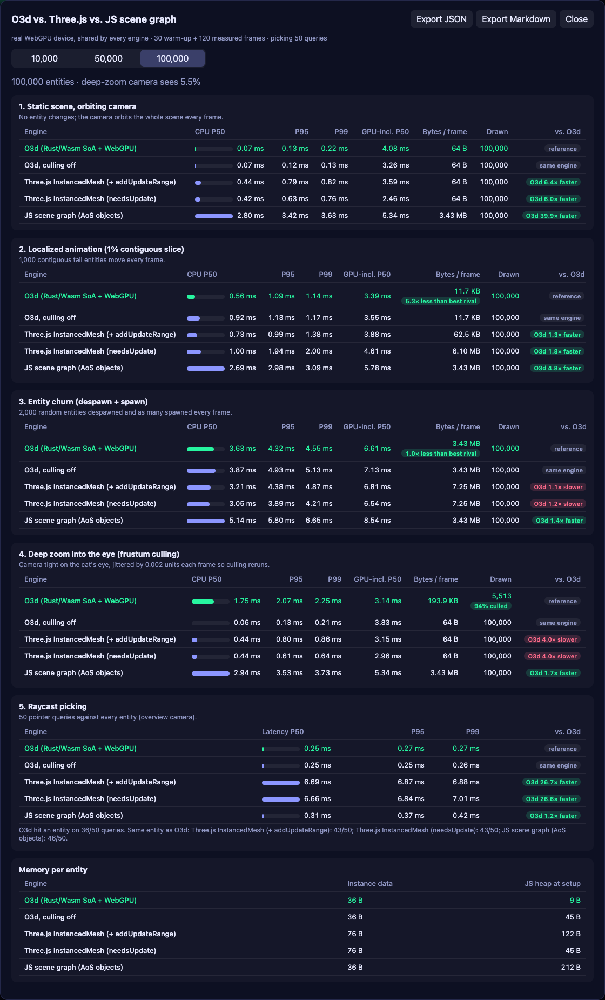

# O3d: Zero-Copy WebGPU Rendering in Rust + WebAssembly

> A 2D/3D instanced rendering engine for the browser. Entity data lives in Rust-owned WebAssembly memory, JavaScript reads it through aliased typed arrays, only the modified byte ranges reach the GPU, and everything visible is drawn in a single instanced draw call.

**[▶ Live playground](https://omern8878.github.io/O3d/)**: a 50,000-particle vector cat you can orbit, zoom, pick and benchmark (WebGPU, with a Canvas2D fallback).

<p align="center">
  
</p>

| 2D orthographic: crisp vector edges | 3D perspective: volumetric relief |
|---|---|
|  |  |
| **Zoomed in: live frustum culling** | **Built-in competitor benchmark** |
|  |  |

A screen recording of the showcase is also available as [WebM](docs/media/cat-showcase.webm).

In the 2D shot, the HUD lists exactly two GPU writes for that frame: the animated tail's position slice (43.7 KB) and the colour slice of the picked eyes (30.5 KB). The other ~44,000 particles upload **0 bytes**.

---

## Benchmark: O3d vs. Three.js vs. a JS Scene Graph

Five engines render the **same deterministic scene**: the sampled vector cat (70%) inside a spherical starfield (30%). They run five workloads, each on a freshly built scene: 30 warm-up frames, then 120 measured frames, one per `requestAnimationFrame` tick. All engines share **one WebGPU device**, and every byte any of them sends is counted by wrapping `GPUQueue.writeBuffer`, so the bandwidth figures are measured at the driver boundary, not self-reported.

| Engine | What it is |
|---|---|
| **O3d** | `SceneTemplate`: Wasm SoA storage, dirty sub-slice uploads, O(1) whole-scene trivial accept, then Wasm frustum culling and stream compaction when needed, Wasm picking. |
| O3d, culling off | The same engine with `enableCulling: false`, to show what culling costs when it cannot be skipped. |
| Three.js (+ `addUpdateRange`) | Three.js r186 `WebGPURenderer` with one `InstancedMesh`, uploading only the touched matrix range; its best-practice path. |
| Three.js (`needsUpdate`) | The same mesh with the idiomatic `instanceMatrix.needsUpdate = true`, which re-uploads the whole attribute. |
| JS scene graph | A `Map` of `{ id, position, scale, color, visible }` objects, repacked and uploaded in full every frame, drawn with O3d's own shader. |

**Results at 100,000 entities** (P50 CPU time per frame; Apple M5, macOS 26.6, Chrome 155 headless with Metal WebGPU, cross-origin isolated for 5 µs timers):

- **Static scenes: O3d is ~6× faster than Three.js.** An orbiting camera costs O3d **0.07 ms** per frame vs. 0.42–0.44 ms for Three.js and 2.80 ms for the JS graph. The scene's bounding volume lies inside the frustum, so O3d's O(1) whole-scene trivial accept skips the per-entity cull entirely and draws straight from the dirty-tracked buffers.
- **Localized animation: O3d is fastest and sends the least.** Moving the 1% tail costs O3d **0.56 ms** and **12,000 B** per frame vs. 0.73 ms and 64,000 B for range-tuned Three.js (5.3× the bytes), 1.00 ms and 6.4 MB for idiomatic Three.js (533×), and 2.69 ms and 3.6 MB for the JS graph.
- **Picking: O3d is ~27× faster than Three.js** (0.25 ms vs. 6.7 ms per query). The JS scene graph is nearly as fast as O3d (0.31 ms): the win comes from testing spheres over flat data rather than from Wasm itself. Three.js extracts every instance matrix and tests the plane's triangles.
- **Deep zoom: only O3d culls per instance**, drawing 5,513 instances (5.5%) where every other engine draws all 100,000. That cull is real work: 1.75 ms of CPU per frame vs. 0.44 ms for Three.js, which does no per-instance culling. On this GPU the end-to-end frame time comes out the same (3.1 ms for both): 100k small quads do not saturate an M5. The draw saving should matter more on weaker GPUs or heavier shaders, which this run did not measure.
- **Churn is still Three.js's best workload.** Despawning and spawning 2,000 random entities per frame costs O3d 3.62 ms vs. 3.05–3.21 ms for Three.js and 5.14 ms for the JS graph. Profiling O3d's frame: the 2,000 removals take ~0.16 ms and the 2,000 additions ~0.35 ms, so JS-to-Wasm call overhead is not the bottleneck. The cost is the upload: random removals spread O3d's single dirty interval across the whole buffer, so it re-sends about 3.6 MB per frame (half of Three's 7.6 MB, but close to a full upload).
- **No sustained GC stalls.** At 100k the worst P50-to-P99 gap is 1.7 ms (Three.js during churn) and retained heap growth over 120 frames is at most ~23 KB. The one outlier was the JS scene graph's churn at 50k (P99 8.6 ms vs. P50 3.4 ms), the pattern of a collection of its discarded node objects. O3d's public `addNode` / `update*` calls still allocate small short-lived objects; V8 collects them without visible pauses at these rates.
- **Memory.** Per-instance GPU data is 36 B for O3d and the JS graph, and 76 B for Three.js (a 4×4 matrix plus a colour). The JS heap per entity is clearly highest for the JS scene graph (~212 B for its object graph). The other engines' figures (9–122 B) include benchmark bookkeeping and follow the run order rather than the engine (identical code shows 9 vs. 45 B), so read them as noise.

Methodology notes: Three.js uses its default `StaticDrawUsage`; with `DynamicDrawUsage` its WebGPU backend re-uploads the instance buffer on every frame even when nothing changed. Three.js picks against the plane's triangles while O3d and the JS graph pick against bounding spheres, so at 100k Three.js agrees with O3d on 43 of 50 queries and the JS graph on 46. Pixi.js is not included: it is a 2D renderer and cannot express the perspective orbit, depth culling or 3D raycast. Sub-millisecond medians move by roughly ±30% between runs; the full 10k / 50k / 100k results are in [`docs/media/benchmark-results.md`](docs/media/benchmark-results.md) and [`docs/media/benchmark-results.json`](docs/media/benchmark-results.json). Re-run them with **Run 100k Benchmark** in the playground or `npm run benchmark`.


<!-- benchmark:start -->
_Real WebGPU device · 30 warm-up + 120 measured frames per workload (picking: 10 + 50 queries) · Mozilla/5.0 (Macintosh; Intel Mac OS X 10_15_7) AppleWebKit/537.36 (KHTML, like Gecko) HeadlessChrome/155.0.0.0 Safari/537.36_

#### 100,000 entities

**1. Static scene, orbiting camera**: No entity changes; the camera orbits the whole scene every frame.

| Engine | CPU P50 | P95 | P99 | GPU-incl. P50 | Bytes / frame | Drawn | O3d vs. engine |
|---|---:|---:|---:|---:|---:|---:|---:|
| **O3d (Rust/Wasm SoA + WebGPU)** | 0.07 ms | 0.13 ms | 0.22 ms | 4.08 ms | 64 B | 100,000 | — |
| O3d, culling off | 0.07 ms | 0.12 ms | 0.13 ms | 3.26 ms | 64 B | 100,000 | same engine |
| Three.js InstancedMesh (+ addUpdateRange) | 0.44 ms | 0.79 ms | 0.82 ms | 3.59 ms | 64 B | 100,000 | 6.4× faster |
| Three.js InstancedMesh (needsUpdate) | 0.42 ms | 0.63 ms | 0.76 ms | 2.46 ms | 64 B | 100,000 | 6.0× faster |
| JS scene graph (AoS objects) | 2.80 ms | 3.42 ms | 3.63 ms | 5.34 ms | 3.43 MB | 100,000 | 39.9× faster |

**2. Localized animation (1% contiguous slice)**: 1,000 contiguous tail entities move every frame.

| Engine | CPU P50 | P95 | P99 | GPU-incl. P50 | Bytes / frame | Drawn | O3d vs. engine |
|---|---:|---:|---:|---:|---:|---:|---:|
| **O3d (Rust/Wasm SoA + WebGPU)** | 0.56 ms | 1.09 ms | 1.14 ms | 3.39 ms | 11.7 KB | 100,000 | — |
| O3d, culling off | 0.92 ms | 1.13 ms | 1.17 ms | 3.55 ms | 11.7 KB | 100,000 | same engine |
| Three.js InstancedMesh (+ addUpdateRange) | 0.73 ms | 0.99 ms | 1.38 ms | 3.88 ms | 62.5 KB | 100,000 | 1.3× faster |
| Three.js InstancedMesh (needsUpdate) | 1.00 ms | 1.94 ms | 2.00 ms | 4.61 ms | 6.10 MB | 100,000 | 1.8× faster |
| JS scene graph (AoS objects) | 2.69 ms | 2.98 ms | 3.09 ms | 5.78 ms | 3.43 MB | 100,000 | 4.8× faster |

**3. Entity churn (despawn + spawn)**: 2,000 random entities despawned and as many spawned every frame.

| Engine | CPU P50 | P95 | P99 | GPU-incl. P50 | Bytes / frame | Drawn | O3d vs. engine |
|---|---:|---:|---:|---:|---:|---:|---:|
| **O3d (Rust/Wasm SoA + WebGPU)** | 3.63 ms | 4.32 ms | 4.55 ms | 6.61 ms | 3.43 MB | 100,000 | — |
| O3d, culling off | 3.87 ms | 4.93 ms | 5.13 ms | 7.13 ms | 3.43 MB | 100,000 | same engine |
| Three.js InstancedMesh (+ addUpdateRange) | 3.21 ms | 4.38 ms | 4.87 ms | 6.81 ms | 7.25 MB | 100,000 | 1.1× slower |
| Three.js InstancedMesh (needsUpdate) | 3.05 ms | 3.89 ms | 4.21 ms | 6.54 ms | 7.25 MB | 100,000 | 1.2× slower |
| JS scene graph (AoS objects) | 5.14 ms | 5.80 ms | 6.65 ms | 8.54 ms | 3.43 MB | 100,000 | 1.4× faster |

**4. Deep zoom into the eye (frustum culling)**: Camera tight on the cat's eye, jittered by 0.002 units each frame so culling reruns.

| Engine | CPU P50 | P95 | P99 | GPU-incl. P50 | Bytes / frame | Drawn | O3d vs. engine |
|---|---:|---:|---:|---:|---:|---:|---:|
| **O3d (Rust/Wasm SoA + WebGPU)** | 1.75 ms | 2.07 ms | 2.25 ms | 3.14 ms | 193.9 KB | 5,513 | — |
| O3d, culling off | 0.06 ms | 0.13 ms | 0.21 ms | 3.83 ms | 64 B | 100,000 | same engine |
| Three.js InstancedMesh (+ addUpdateRange) | 0.44 ms | 0.80 ms | 0.86 ms | 3.15 ms | 64 B | 100,000 | 4.0× slower |
| Three.js InstancedMesh (needsUpdate) | 0.44 ms | 0.61 ms | 0.64 ms | 2.96 ms | 64 B | 100,000 | 4.0× slower |
| JS scene graph (AoS objects) | 2.94 ms | 3.53 ms | 3.73 ms | 5.34 ms | 3.43 MB | 100,000 | 1.7× faster |

**5. Raycast picking**: 50 pointer queries against every entity (overview camera).

| Engine | Latency P50 | P95 | P99 | O3d vs. engine |
|---|---:|---:|---:|---:|
| **O3d (Rust/Wasm SoA + WebGPU)** | 0.25 ms | 0.27 ms | 0.27 ms | — |
| O3d, culling off | 0.25 ms | 0.25 ms | 0.26 ms | same engine |
| Three.js InstancedMesh (+ addUpdateRange) | 6.69 ms | 6.87 ms | 6.88 ms | 26.7× faster |
| Three.js InstancedMesh (needsUpdate) | 6.66 ms | 6.84 ms | 7.01 ms | 26.6× faster |
| JS scene graph (AoS objects) | 0.31 ms | 0.37 ms | 0.42 ms | 1.2× faster |

_O3d hit an entity on 36/50 queries. Same entity as O3d: Three.js InstancedMesh (+ addUpdateRange): 43/50; Three.js InstancedMesh (needsUpdate): 43/50; JS scene graph (AoS objects): 46/50._

**Memory per entity**

| Engine | Instance data | JS heap at setup |
|---|---:|---:|
| O3d (Rust/Wasm SoA + WebGPU) | 36 B | 9 B |
| O3d, culling off | 36 B | 45 B |
| Three.js InstancedMesh (+ addUpdateRange) | 76 B | 122 B |
| Three.js InstancedMesh (needsUpdate) | 76 B | 45 B |
| JS scene graph (AoS objects) | 36 B | 212 B |
<!-- benchmark:end -->

---

## At a Glance

| Guarantee | What it means |
|-----------|---------------|
| Zero-copy | Typed arrays alias Wasm linear memory; entity data is never serialized or duplicated on the JS side. |
| O(1) ECS | Sparse-set indexing with Structure-of-Arrays storage: constant-time create, remove and lookup. |
| Idle = 0 bytes | Unchanged scenes upload nothing, whether fully visible or culled; edits upload only the touched slice. |
| One draw call | All visible entities render as instanced quads in a single `draw`. |
| Culled on the CPU | O(1) whole-scene trivial accept first; otherwise Gribb-Hartmann culling with stream compaction sends only visible instances. |
| Camera-facing SDF shapes | Billboarded quads with analytically anti-aliased discs: smooth at any zoom, solid from any angle. |
| Pixel-accurate picking | Click or tap any point to get the entity under it, nearest-first, in 2D and 3D. |
| Measurable | `getFrameStats()` reports drawn instances and every byte uploaded, per frame. |
| Read-only by type | Consumers receive immutable views; the engine owns all writes. |
| Panic-free boundary | Invalid input from JavaScript cannot crash the Wasm module. |

## Quick Start

```bash
npm install
npm run build   # Rust → Wasm (wasm-pack), the library bundle and the playground
npm run dev     # playground on http://localhost:5173
npm test        # every TypeScript unit, integration, benchmark and end-to-end test
```

Building needs Rust with the `wasm32-unknown-unknown` target, [`wasm-pack`](https://rustwasm.github.io/wasm-pack/) and Node.js 22+. Rendering needs a browser with WebGPU (recent Chrome, Edge or Safari) served over HTTPS or `localhost`; elsewhere the playground falls back to a Canvas2D preview of the same pipeline.

The library builds to a self-contained ES module: the JavaScript bundle, type declarations, and the Wasm binary next to them. It has no runtime dependencies and needs no bundler plugins.

---

## How It Works

```text
Rust ECS in Wasm memory ──zero-copy views──▶ dirty-range tracking ──sub-slice uploads──▶ GPU instance buffers ──▶ 1 draw call
          ▲                                                                                      ▲
 Camera + frustum culling + picking (Rust) ──────── 64-byte view-projection uniform, sent only when it changes
```

1. You create and update entities by stable ID; data is written straight into Wasm memory.
2. The engine records which index range of each channel (position, scale, colour) changed.
3. Optionally, it culls entities outside the camera's view and compacts the visible ones.
4. Only the changed (or newly visible) bytes are uploaded to the GPU.
5. Everything is drawn in one instanced draw call.

### O(1) Entity Component System
A **sparse set** maps stable entity IDs to dense indices, and components are stored as **Structure-of-Arrays** (positions, scales and colours, three `f32` each). The arrays are tightly packed, so the GPU consumes them directly as vertex buffers and the CPU iterates them cache-friendly.

- **Create:** reuses a freed ID or appends; capacity doubles when full, so cost is O(1) amortized.
- **Remove:** **swap-and-pop** moves the last entity into the vacated slot, keeping arrays gap-free in O(1). The overwritten slot is reported so exactly that slot is re-uploaded.
- **Lookup:** a direct array read; stale or invalid IDs resolve to "not found" instead of failing.

### Dirty Sub-Slice Uploads
Change tracking keeps one inclusive `[min, max]` interval of dense indices per channel. Each frame issues **at most one `writeBuffer` per dirty channel, covering only that interval**.

- **Nothing changed:** zero instance uploads, zero bytes. The camera uniform is skipped too unless the camera moved.
- **One entity edited:** a single 12-byte write on the channel that changed.
- **A contiguous group animated:** one write covering exactly that group, which is why the playground stores the cat's tail as one contiguous index range.
- **Deliberate trade-off:** one interval per channel means clean entities between two dirty ones are re-sent, in exchange for a single contiguous write.

### Gribb-Hartmann Frustum Culling with Stream Compaction
Six normalized frustum planes are extracted directly from the column-major view-projection matrix (Gribb-Hartmann), adapted to WebGPU's `[0, 1]` depth range (`near = row 2`, `far = row 3 − row 2`). Each entity is tested as a bounding sphere whose radius is half the diagonal of its scale. **Stream compaction** then copies only the visible entities into packed arrays, reusing allocated capacity every frame.

Before any of that, an **O(1) whole-scene trivial accept** runs. The engine keeps a conservative bounding volume of every entity: a sphere and an axis-aligned box, grown in O(1) on each write. If either lies fully inside all six planes, no entity can be off-screen, so the per-entity cull and compaction are skipped. The sphere suits round scenes, the box flat 2D ones. Bounds only grow between writes. When a grown volume fails the test, it is recomputed exactly in one Wasm pass and retried, so looseness never costs a missed fast path. A trivial accept can only cause more to be drawn, never less, so a loose bound is always visually safe.

| Situation | Behaviour | Instance upload |
|-----------|-----------|-----------------|
| Whole scene inside the frustum (O(1) bounds test) | Dirty-tracked full path; no per-entity cull | Dirty sub-slices only (0 bytes if unchanged) |
| Everything visible, bounds inconclusive | Per-entity cull, then the dirty-tracked full path | Dirty sub-slices only (0 bytes if unchanged) |
| Partially visible, nothing changed | Previous visible set redrawn; no cull | None |
| Partially visible, camera or entities changed | Re-cull and compact | The visible set |
| Nothing visible | Clear the screen only | None; draw skipped |

When the view returns to "everything visible", all entities are marked dirty once so the GPU resynchronizes with the full arrays.

### Raycasting & Spatial Picking
A screen point is unprojected through the **inverse view-projection matrix** (adjugate/determinant inverse, rejected when singular) into a world-space ray from the near plane (`z = 0`) to the far plane (`z = 1`) of WebGPU's clip range. Wasm intersects the ray with each entity's bounding sphere (radius `0.5 × largest scale component`) and keeps the **nearest hit along the ray**, so overlapping entities resolve by depth in both orthographic and perspective views. Picking returns the stable `EntityId`, needs no GPU round-trip, and returns `null` for non-finite input, an empty scene or a non-invertible camera.

### Camera-Facing SDF Shapes
Every instance is a unit quad expanded in **view space**, so it always faces the camera. Rendering then agrees with the spheres used for culling and picking, and a 3D point cloud stays solid from every angle. For a rigid view and a standard projection, a view-space offset `(dx, dy, 0)` moves the clip position by `(|row₀(VP)|·dx, |row₁(VP)|·dy)` and leaves `w` unchanged, so the shader needs only the existing `view_proj` uniform. In a front-on 2D view the result is identical to world-aligned quads.

In **circle** mode the fragment shader computes the distance from the quad's centre, discards outside the unit circle, and derives edge coverage from its screen-space derivative (`1 − smoothstep(1 − fwidth, 1, dist)`). The output is premultiplied alpha, so overlapping discs blend correctly. **Quad** mode is crisp and opaque. The shape is a pipeline-overridable constant, so the unused branch costs nothing.

---

## Hard Invariants

| # | Invariant | Details |
|---|-----------|---------|
| 1 | **Matrix order** | Strict **column-major** `[f32; 16]` matching WGSL `mat4x4<f32>`: element `(row, col)` lives at `m[col * 4 + row]`, and matrices act on column vectors (`clip = projection * view * model * point`). Never transpose to "fix" a bug; fix the producer. |
| 2 | **Depth range** | WebGPU **zero-to-one, right-handed** clip depth (`orthographic_rh_zo`, `perspective_rh_zo`): near plane at `z = 0`, far plane at `z = 1`. The camera looks down its local `−Z`. |
| 3 | **Memory model** | **Zero-copy** `Float32Array` views alias Wasm linear memory. A view dies when the Rust arrays reallocate **or** when Wasm memory grows (`memory.grow` detaches the old `ArrayBuffer`). The engine re-syncs views automatically on both events (a capacity or `byteLength` check); never hold a raw view across a call that can allocate. |
| 4 | **Encapsulation** | Consumers only receive `ReadonlyFloat32Array`-based views. Every write goes through the public managers so change tracking stays correct. |

Corollaries:

- **One consumer clears dirty state.** Only the GPU upload step reads and resets change tracking.
- **IDs are stable, indices are not.** An `EntityId` is valid for the entity's whole life; its dense index changes when other entities are removed.
- **Culled frames break the dense mirror.** After drawing a compacted subset, the GPU no longer mirrors the full arrays, so the renderer re-marks everything dirty before returning to the full path.
- **The Wasm boundary is hostile input.** Every exported method tolerates `NaN`, infinities, zero, stale IDs and degenerate geometry without panicking.

## Memory Safety & Security

### Read-only encapsulation (compile time)
Zero-copy views expose live engine memory, so consumers get **compile-time immutable** types. `ReadonlyFloat32Array` and `ReadonlyUint32Array` remove `set`, `fill`, `copyWithin`, `reverse` and `sort`, make element access read-only, and keep `subarray` slices read-only too. Entity views, culling results and the camera matrix all use them.

```ts
const { positions } = scene.getNodeViews();

positions[0] = 1;          // TS error: index signature only permits reading
positions.set([1, 2, 3]);  // TS error: 'set' does not exist
```

The only place a view is cast back to a writable array is the final GPU `writeBuffer`, which only reads from it. Raw Wasm structs and `wasm_memory` are never exported from the package entry point.

> Immutability is enforced by the type system, not at runtime. Plain JavaScript can still write to the underlying memory, so treat the views as read-only.

### Wasm boundary input sanitization (runtime)
Everything crossing from JavaScript into Rust is validated, so no call sequence can trigger a Wasm `panic!`:

- **Capacities** are clamped to a safe range (minimum 1); growth arithmetic saturates instead of overflowing.
- **Entity IDs** that are out of range, stale or already removed are ignored.
- **Camera inputs** that are `NaN`, infinite or out of range are ignored and the previous state is kept (`is_finite()` checks and range bounds). Aspect ratios outside `[1e-4, 1e4]` are rejected, and zoom values are clamped.
- **Degenerate geometry** (eye on the target, or an up vector that is zero or parallel to the view direction) still yields a valid, finite, orthonormal view matrix.
- Each of these cases is covered by regression tests.

> Known limit: genuine Wasm memory exhaustion traps instead of raising a catchable error.

---

## API

### `SceneTemplate`: everything in one object

```ts
import { initEngine, SceneTemplate } from "@engine/templates";

await initEngine(); // load the Wasm module once

const canvas = document.querySelector<HTMLCanvasElement>("#render-canvas")!;
const scene = await SceneTemplate.create({
  canvas,
  cameraMode: "perspective3d", // or "ortho2d" (default)
  shapeMode: "circle",         // anti-aliased SDF discs (default); "quad" for crisp squares
  enableCulling: true,         // draw only what is on screen (default)
  initialCapacity: 100_000,
});

// Nodes are plain tuples: position, scale (size), colour (r, g, b in 0..1).
const a = scene.addNode([-20, 0, 0], [12, 12, 12], [0.2, 0.7, 1.0]);
const b = scene.addNode([20, 10, 0], [8, 8, 8], [1.0, 0.5, 0.2]);

scene.updateNodePosition(b, [25, 15, 0]);
scene.updateNodeColor(a, [1, 1, 1]);
scene.removeNode(b); // true if the node existed

canvas.addEventListener("pointerdown", (event) => {
  const hit = scene.pickNodeAtScreen(event.clientX, event.clientY, canvas.getBoundingClientRect());
  if (hit !== null) scene.updateNodeColor(hit, [1, 0, 0]);
});

scene.setShapeMode("quad");          // switch shapes at runtime
scene.setCameraMode("ortho2d");      // or projections
scene.getCameraController().resize(canvas.width, canvas.height);

function frame() {
  scene.renderFrame();
  const { drawnCount, totalCount, uploadedBytes, uploads } = scene.getFrameStats();
  // e.g. uploadedBytes === 0 for an unchanged frame
  requestAnimationFrame(frame);
}
requestAnimationFrame(frame);
```

`SceneTemplate` composes the managers below; reach for them directly when you need finer control.

### `EntityManager`: create and update entities

```ts
import { EntityManager } from "@engine/templates";

const entities = new EntityManager(1000); // initial capacity; grows automatically

const id = entities.createEntity({
  position: { x: 10, y: 20, z: 0 },
  scale: { x: 12, y: 12, z: 1 },
  color: "#ff8800", // or { r: 1, g: 0.5, b: 0 } with channels in 0..1
});

entities.updateEntity(id, { position: { x: 15 } }); // partial update, tracked as dirty
entities.removeEntity(id);                          // unknown IDs are ignored

const { positions } = entities.getRawViews();       // read-only zero-copy view
```

### `CameraController`: 2D and 3D views

```ts
import { CameraController } from "@engine/templates";

const camera = new CameraController({ mode: "2d", orthoHalfHeight: 100 });
camera.resize(canvas.width, canvas.height); // keeps the aspect ratio correct
camera.panByPixels(dx, dy, canvas.height);  // drag to pan
camera.zoom(0.9);                           // < 1 zooms in, > 1 zooms out
camera.setOrthoHalfHeight(120);             // absolute 2D extent

const orbit = new CameraController({
  mode: "3d",
  position: { x: 0, y: 5, z: 20 },
  target: { x: 0, y: 0, z: 0 },
});
orbit.orbit(0.02, -0.01);                   // azimuth, elevation (radians)
const viewProj = orbit.getViewProjection(); // read-only column-major 4×4
```

### `PickingController`: entity under the pointer

```ts
import { PickingController } from "@engine/templates";

const picking = new PickingController();

canvas.addEventListener("pointerdown", (event) => {
  const id = picking.pickAtScreenCoords(
    event.clientX, event.clientY, canvas.getBoundingClientRect(), entities, camera,
  );
  if (id !== null) entities.updateEntity(id, { color: "#ffffff" });
});

const hit = picking.pickByNdc(0, 0, entities, camera); // NDC x, y in [-1, 1], +Y up
```

### `InstancedRenderer` and `CullingManager`: the render loop by hand

```ts
import { CullingManager, GpuContext, InstancedRenderer } from "@engine/templates";

const gpu = await GpuContext.create({ canvas, clearColor: { r: 0.05, g: 0.05, b: 0.1, a: 1 } });
const renderer = new InstancedRenderer(gpu, 1000, "circle");
const culling = new CullingManager(1000);

function frame() {
  gpu.resizeToDisplaySize();
  camera.resize(canvas.width, canvas.height);
  renderer.renderCulled(entities, camera, culling); // or: camera.syncIfDirty(renderer); renderer.render(entities);
  requestAnimationFrame(frame);
}
```

### `BenchmarkSuite` and `createHeadlessGpuContext`

```ts
import { BenchmarkSuite, GpuContext, createHeadlessGpuContext } from "@engine/templates";

// With a real device the report includes driver upload costs…
const report = await new BenchmarkSuite(await GpuContext.create({ canvas })).run({ entityCount: 100_000 });
// …or run CPU-only anywhere (Node, CI) with uploads counted and discarded.
const cpuOnly = await new BenchmarkSuite().run({ entityCount: 20_000 });

// The same headless context runs a full SceneTemplate without a GPU.
const scene = new SceneTemplate(createHeadlessGpuContext());
```

---

## The Playground

The live playground opens straight into the vector cat showcase:

- **Vector → particles.** A layered SVG (body, chest, ears with pink insides, curled tail, emerald eyes with vertical pupils, nose, mouth, whiskers) is parsed and sampled into 20k / 50k / 100k particles. Dense contour samples give razor-sharp edges, low-discrepancy fill samples give solid interiors, and a stacked relief height field gives each layer depth. The result reads as flat vector art in 2D and as a hologram when orbited.
- **Dirty sub-slice proof.** Every named layer is one contiguous index range. The tail is animated with a travelling wave each frame, and the HUD lists the exact writes: the tail's position slice, and nothing for the static body.
- **Interact.** Drag to orbit (Shift or right-drag to pan), wheel or pinch to zoom into the face and watch *Visible drawn* fall below *Total entities*. Click or tap any part to raycast-pick it: the HUD shows its `EntityId` and body part, and the part pulses gold.
- **Controls.** Camera (3D perspective / 2D ortho), shape (SDF circle / quad), particle count, tail animate / freeze, **Upload Custom SVG** (paths, basic shapes, groups, transforms, inline styles, both fill rules), and **Run 100k Benchmark**.
- **Fallback.** Without a WebGPU adapter the same pipeline runs on a headless GPU context and a software rasterizer draws it. The HUD badges the active backend.

## Development

| Command | What it does |
|---------|--------------|
| `npm run build:wasm` | Compiles the Rust engine to WebAssembly with `wasm-pack`. |
| `npm run build` | Wasm, then the publishable library bundle and declarations, then the playground production build. |
| `npm test` | All TypeScript tests across the workspaces (Node's built-in runner; no GPU needed). |
| `npm run dev` | Playground dev server with hot reload. |
| `npm run capture:media` | Re-captures the screenshots, GIF and WebM above with headless Chrome (after `npm run build`). |
| `npm run benchmark` | Runs the competitor benchmark at 10k / 50k / 100k entities in headless Chrome on real WebGPU, writes the JSON / Markdown / PNG reports and refreshes the tables in this README (after `npm run build`). |
| `cargo fmt --check`, `cargo clippy --all-targets -- -D warnings`, `cargo test` | Rust formatting, lints and unit tests (run in the engine crate). |

Continuous integration runs all of the above on every push and pull request. Every push to `main` also deploys the playground to GitHub Pages.

## License

MIT
